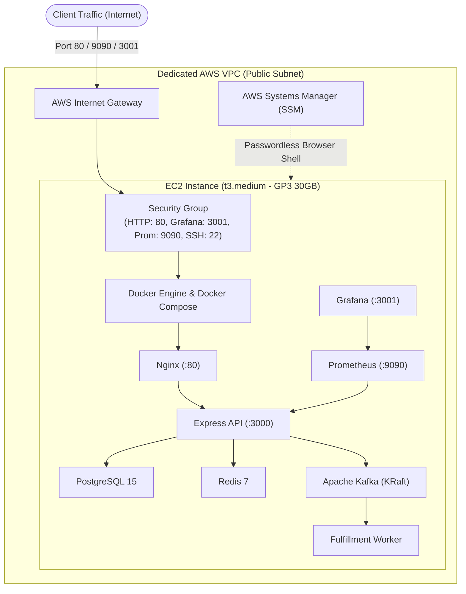

# AWS Deployment Guide: AWS CDK vs. AWS SDK

This guide explains why **AWS CDK** is the industry standard for software developers deploying cloud infrastructure, and walks you through deploying this entire backend stack to AWS.

---

## 1. AWS CDK vs. AWS SDK: The Software Developer Perspective

As a software developer, choosing between **AWS CDK** and **AWS SDK** for deployment is a fundamental architectural decision:

| Feature | AWS CDK (Cloud Development Kit) | AWS SDK (Software Development Kit) |
| :--- | :--- | :--- |
| **Primary Purpose** | **Infrastructure as Code (IaC)** & Deployments | **Runtime Application Code** |
| **How it Works** | Declarative constructs in TypeScript compiled to **CloudFormation** | Imperative API calls (`ec2.runInstances()`, `s3.getObject()`) |
| **State Management** | **Automatic state tracking** & diffing (`cdk diff`) | **None** (You must manually track what was created) |
| **Rollbacks on Failure** | **Automatic atomic rollback** if any resource fails | **None** (Leaves orphaned resources and half-built infra) |
| **Security & Defaults** | Generates least-privilege IAM policies automatically | Manual policy crafting (prone to security oversights) |
| **When to Use** | Creating VPCs, EC2, ECS, RDS, Load Balancers, S3 buckets | Inside your Express/Worker code (e.g. uploading a file to S3) |

> **Verdict for Developers:** **Always use AWS CDK for deploying infrastructure.** Use AWS SDK only *inside* your application code for runtime interactions.

---

## 2. Infrastructure Architecture Provisioned by CDK

The CDK stack in `cdk/lib/ecommerce-stack.ts` provisions:



---

## 3. Step-by-Step Deployment Instructions

### Step 1: Configure Your AWS Credentials
In your PowerShell terminal:
```powershell
aws configure
# Enter your AWS Access Key ID, Secret Access Key, and Default region (e.g. us-east-1)
```

---

### Step 2: Install CDK Dependencies & Bootstrap AWS
Navigate into the `cdk` directory:

```powershell
cd d:\AWS_Practice\AWS_learning\cdk

# Install CDK dependencies
npm install

# Bootstrap your AWS account for CDK (one-time setup per account/region):
npx cdk bootstrap
```

---

### Step 3: Review and Deploy the CloudFormation Stack
```powershell
# See what AWS will create before deploying:
npx cdk diff

# Deploy the infrastructure to AWS:
npx cdk deploy
```

Type `y` when prompted to approve IAM security changes.

**Upon completion, CloudFormation will print the outputs:**
```text
Outputs:
EcommerceBackendStack.InstancePublicIP = 54.210.xx.xx
EcommerceBackendStack.ApiEndpoint = http://54.210.xx.xx
EcommerceBackendStack.GrafanaDashboard = http://54.210.xx.xx:3001
EcommerceBackendStack.PrometheusMetrics = http://54.210.xx.xx:9090
```

---

### Step 4: Transfer Code & Launch the Application on EC2

You can connect to your EC2 instance easily using **AWS Systems Manager (SSM)** directly from the AWS Console (no SSH key needed!), or via SSH:

#### Option A: Connect via AWS Console (SSM Session Manager)
1. Go to AWS Console $\rightarrow$ **EC2** $\rightarrow$ Click on `EcommerceAppServer`.
2. Click **Connect** $\rightarrow$ Choose **Session Manager** $\rightarrow$ Click **Connect**.
3. You get a root terminal in your browser!

#### Option B: Deploy Code to the Server
Once in the server shell:
```bash
# 1. Switch to ec2-user directory
cd /home/ec2-user

# 2. Clone your repository or scp the project files
git clone <your-git-repo-url> app
cd app

# 3. Boot all containers!
docker compose up -d --build

# 4. Verify running containers:
docker compose ps
```

---

### Step 5: Test the Live Cloud Endpoints

From your laptop/terminal:

```powershell
$IP = "54.210.xx.xx" # Replace with your CDK output IP

# 1. Register a user on AWS:
Invoke-RestMethod -Uri "http://$IP/api/auth/register" `
  -Method Post `
  -ContentType "application/json" `
  -Body '{"username":"aws_candidate","password":"CloudPassword123!"}'

# 2. Login:
$auth = Invoke-RestMethod -Uri "http://$IP/api/auth/login" `
  -Method Post `
  -ContentType "application/json" `
  -Body '{"username":"aws_candidate","password":"CloudPassword123!"}'
$token = $auth.token

# 3. Test Redis Cache miss/hit on AWS:
Invoke-RestMethod -Uri "http://$IP/api/products/1" -Method Get

# 4. Place transactional order:
Invoke-RestMethod -Uri "http://$IP/api/orders" `
  -Method Post `
  -Headers @{ Authorization = "Bearer $token" } `
  -ContentType "application/json" `
  -Body '{"productId": 1, "quantity": 1}'
```

---

### Step 6: Clean Up (Avoid Unwanted AWS Charges)

When you are done testing, destroy the entire AWS infrastructure with a single command:

```powershell
cd d:\AWS_Practice\AWS_learning\cdk
npx cdk destroy
```
CloudFormation will cleanly delete the EC2 instance, security groups, and VPC with zero leftover billable resources!

