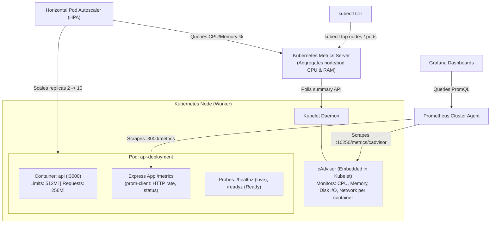

# Kubernetes Container Monitoring & Observability Scenarios

This guide walks you step-by-step through setting up, monitoring, and triggering real-world container failure and auto-healing scenarios in Kubernetes.

---

## 1. Kubernetes Monitoring Architecture

Understanding the different layers of Kubernetes monitoring is critical for both operations and system design interviews:



### The 3 Monitoring Tiers in Kubernetes:
1. **Host & Container Resource Tier (cAdvisor + Metrics Server):**
   * Built directly into the `kubelet` binary on every node.
   * Tracks container cgroup statistics (`cpu.stat`, `memory.current`).
   * Feeds `kubectl top pods` and the `HorizontalPodAutoscaler` (HPA).
2. **Application Telemetry Tier (Prometheus + ServiceMonitor):**
   * Scrapes the `/metrics` endpoint inside the container.
   * Tracks business and request-level metrics (e.g. `ecommerce_http_requests_total`, request latency, status codes).
3. **Container Lifecycle & Health Probes (Kubelet Probes):**
   * `livenessProbe`: Determines if the container needs a restart.
   * `readinessProbe`: Determines if the container can receive network traffic.
   * `startupProbe`: Protects slow-booting applications from premature restarts.

---

## 2. Hands-On Scenarios

We have implemented live chaos testing hooks directly into `src/api/server.ts` and `k8s/app-deployment.yaml`.

---

### Scenario 1: Memory Leak & OOMKilled (Exit Code 137)

#### Concept:
When a container exceeds its configured `resources.limits.memory` (e.g., 512Mi), the Linux kernel's **Out-Of-Memory (OOM) Killer** terminates the process with SIGKILL (Exit code 137: `128 + 9 = 137`). The `kubelet` detects this and attempts to restart the container, triggering a `CrashLoopBackOff` if repeated.

#### Hands-On Steps:
1. **Deploy the application in Kubernetes:**
   ```bash
   kubectl apply -f k8s/app-deployment.yaml
   kubectl get pods -w
   ```

2. **Forward local port to the pod:**
   ```bash
   kubectl port-forward svc/api-service 3000:3000
   ```

3. **Monitor the pod in a separate terminal:**
   ```bash
   # Watch pod status, restart count, and memory usage
   kubectl get pods -l app=api -w
   ```

4. **Trigger the simulated 1GB memory leak:**
   ```bash
   curl -X POST http://localhost:3000/chaos/leak-memory
   ```

5. **Observe and Diagnose the Failure:**
   ```bash
   # Check pod status (Notice RESTARTS increments and Status shows OOMKilled or CrashLoopBackOff)
   kubectl get pods -l app=api

   # Inspect container termination details:
   kubectl describe pod -l app=api
   ```
   **Look for this exact output in `describe pod`:**
   ```text
   Last State:     Terminated
     Reason:       OOMKilled
     Exit Code:    137
     Started:      Wed, 04 Nov 2026 01:20:00 +0000
     Finished:     Wed, 04 Nov 2026 01:21:15 +0000
   ```

6. **Prometheus PromQL Query to Detect OOM in Dashboards:**
   ```promql
   # Detect pods killed by OOM within the last 15 minutes:
   kube_pod_container_status_last_terminated_reason{reason="OOMKilled"} > 0
   ```

---

### Scenario 2: Container Deadlock & Liveness Probe Auto-Healing

#### Concept:
A deadlock or infinite loop makes a container unresponsive to incoming requests, but the process is technically still running (pid alive). Standard process managers cannot detect this. Kubernetes **Liveness Probes** periodically ping `/healthz`. If it fails 3 consecutive times (`failureThreshold: 3`), Kubernetes terminates and restarts the container.

#### Hands-On Steps:
1. **Check current restart count (should be 0):**
   ```bash
   kubectl get pods -l app=api
   ```

2. **Break the liveness probe:**
   ```bash
   curl -X POST http://localhost:3000/chaos/break-liveness
   ```

3. **Check `/healthz` directly:**
   ```bash
   curl -i http://localhost:3000/healthz
   # Returns: HTTP 500 {"status":"FAIL","reason":"Simulated container deadlock"}
   ```

4. **Watch Kubernetes auto-heal within 15 seconds:**
   ```bash
   kubectl get pods -l app=api -w
   ```
   *Within ~15–20s (3 failures * 5s period), you will see:*
   ```text
   NAME                              READY   STATUS    RESTARTS   AGE
   api-deployment-7bb9d4798c-x9kz2   1/1     Running   1          2m
   ```

5. **Inspect the Kubelet event log:**
   ```bash
   kubectl describe pod -l app=api
   ```
   *Under Events, notice:*
   ```text
   Warning  Unhealthy  12s   kubelet  Liveness probe failed: HTTP probe failed with statuscode: 500
   Normal   Killing    12s   kubelet  Container api failed liveness probe, will be restarted
   Normal   Created    3s    kubelet  Created container api
   ```

---

### Scenario 3: Real-Time CPU / Memory Saturation & Autoscaling (HPA)

#### Concept:
Under high traffic, container CPU spikes. With `k8s/monitoring/hpa.yaml`, the `HorizontalPodAutoscaler` queries the Metrics Server every 15 seconds and automatically scales the deployment from 2 replicas up to 10.

#### Hands-On Steps:
1. **Apply the HPA:**
   ```bash
   kubectl apply -f k8s/monitoring/hpa.yaml
   kubectl get hpa
   ```

2. **Check current resource consumption via Metrics Server:**
   ```bash
   kubectl top pods -l app=api
   kubectl top nodes
   ```

3. **Generate synthetic load (Stress Test):**
   ```bash
   # Run an Apache Bench or curl loop in another terminal:
   # (Sends 10,000 requests with 50 concurrent workers)
   ab -n 10000 -c 50 http://localhost:3000/api/products/1
   ```

4. **Watch HPA dynamically spin up additional pods:**
   ```bash
   kubectl get hpa -w
   ```
   *Output progression:*
   ```text
   NAME      REFERENCE                   TARGETS   MINPODS   MAXPODS   REPLICAS   AGE
   api-hpa   Deployment/api-deployment   12%/60%   2         10        2          1m
   api-hpa   Deployment/api-deployment   78%/60%   2         10        4          2m
   api-hpa   Deployment/api-deployment   85%/60%   2         10        6          3m
   ```

---

### Scenario 4: Monitoring Application Metrics via Prometheus & Grafana

#### Concept:
`k8s/monitoring/service-monitor.yaml` tells the Prometheus Operator to discover and scrape `/metrics` on all pods matching `app: api` every 5 seconds.

#### Essential PromQL Monitoring Queries:

1. **Request Rate (Queries per second per route):**
   ```promql
   sum(rate(ecommerce_http_requests_total[1m])) by (route, method)
   ```

2. **Error Rate (Percentage of 5xx HTTP responses):**
   ```promql
   sum(rate(ecommerce_http_requests_total{status_code=~"5.."}[1m])) 
   / 
   sum(rate(ecommerce_http_requests_total[1m])) * 100
   ```

3. **Container Memory vs Limit (Percentage of limit consumed):**
   ```promql
   sum(container_memory_working_set_bytes{container="api"}) by (pod) 
   / 
   sum(container_spec_memory_limit_bytes{container="api"}) by (pod) * 100
   ```

4. **Container CPU Throttling Rate:**
   ```promql
   sum(rate(container_cpu_cfs_throttled_periods_total[5m])) 
   / 
   sum(rate(container_cpu_cfs_periods_total[5m])) * 100
   ```

---

## 3. Top System Design & SRE Interview Questions on K8s Monitoring

### Q1: What is the difference between `container_memory_usage_bytes` and `container_memory_working_set_bytes`? Which one triggers an OOMKill?
* **Answer:**
  * `container_memory_usage_bytes` includes page cache (cached files on disk) that the kernel can reclaim if needed.
  * `container_memory_working_set_bytes` is the memory that **cannot** be reclaimed (active anonymous memory + recent file pages).
  * **Critical Interview Point:** The Linux OOM Killer evaluates **`container_memory_working_set_bytes`** against the container's memory limit. Always set alerts and Grafana dashboards against the working set, not total usage, otherwise you will get false alarms caused by Linux disk caching.

### Q2: What is CPU Throttling, and why is it dangerous even if CPU usage is below 100%?
* **Answer:**
  * In Linux, CPU limits are enforced using the Completely Fair Scheduler (CFS) quota period (default: 100ms).
  * If a container is assigned `cpu: 500m` (50ms per 100ms window) and consumes its 50ms allocation in the first 20ms of the window, it is **throttled** (frozen) for the remaining 80ms, causing latency spikes and timeouts even though average CPU utilization over a 1-minute window appears low.

### Q3: Why should Readiness and Liveness probes have different endpoints?
* **Answer:**
  * **Liveness Probe (`/healthz`):** Checks if the process is alive. If it fails, Kubernetes **kills and restarts** the container. It should NOT check external dependencies (like PostgreSQL or Kafka), because if the database goes down, restarting all API containers creates a restart storm (thundering herd) that will overwhelm the recovering database.
  * **Readiness Probe (`/readyz`):** Checks if the container can currently handle traffic (e.g. database pool ready, cache warm). If it fails, Kubernetes simply **removes the pod from the Service load balancer**, stopping traffic without unnecessarily restarting the container.

