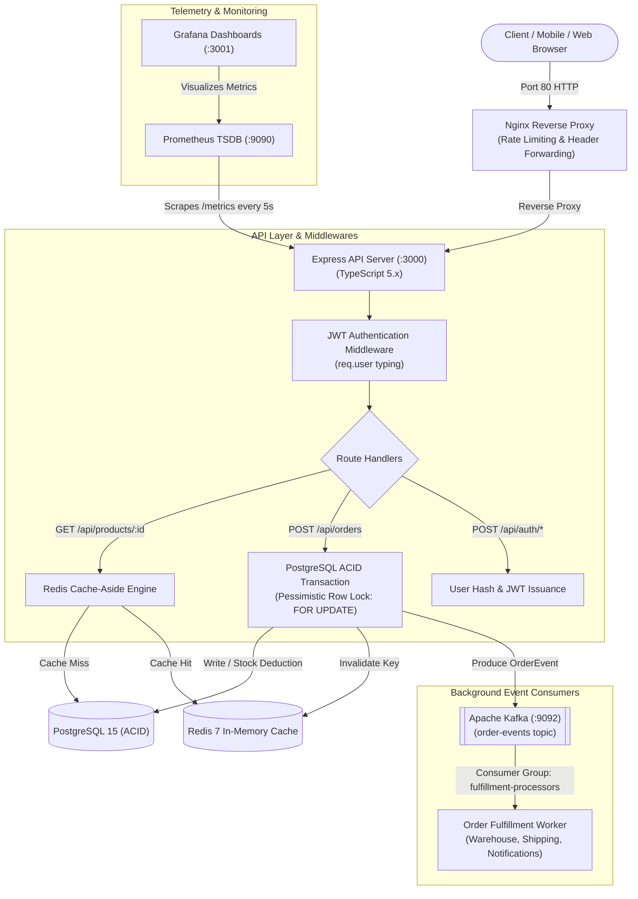
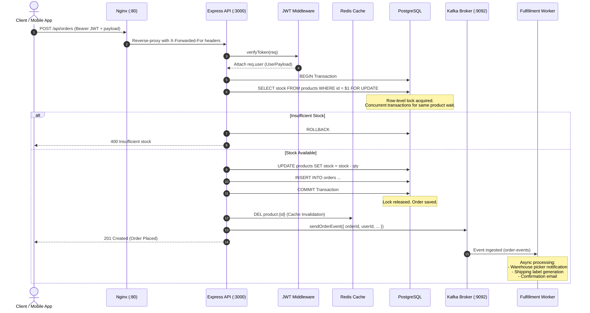

# Backend Request Lifecycle & System Design: Learning & Interview Guide

This document provides a comprehensive deep dive into the architecture, design choices, concurrency control, caching strategies, event-driven decoupling, and senior backend interview concepts implemented in this repository.

---

## 1. System Architecture & Request Lifecycle

### End-to-End Architectural Flow


---

### Transactional Order Flow Sequence (`POST /api/orders`)


---

## 2. Core Architectural Pillars & Deep Dives

### A. Reverse Proxy (Nginx) & Dynamic DNS Resolution
* **Offloading Node.js:** Node.js runs an asynchronous single-threaded event loop. If it spends CPU cycles terminating TLS, negotiating SSL handshakes, buffering slow client uploads, or serving static assets, the event loop starves. Nginx handles connection pooling and buffers requests.
* **Header Propagation:**
  ```nginx
  proxy_set_header Host $host;
  proxy_set_header X-Real-IP $remote_addr;
  proxy_set_header X-Forwarded-For $proxy_add_x_forwarded_for;
  ```
  Without these headers, Node.js sees every request originating from Nginx's internal container IP (`172.x.x.x`), preventing accurate IP-based rate limiting, geo-location, and auditing.
* **Dynamic Docker DNS Resolution (`127.0.0.11`):**
  In containerized Docker Compose / Swarm environments, when a backend container restarts or is rebuilt, Docker reassigns it a new IP address. Static `upstream` blocks in Nginx cache the initial IP at startup, causing `113: Host is unreachable`. Using:
  ```nginx
  resolver 127.0.0.11 valid=5s ipv6=off;
  set $backend_api http://api:3000;
  proxy_pass $backend_api;
  ```
  instructs Nginx to query Docker's embedded DNS server (`127.0.0.11`) every 5 seconds, ensuring zero downtime during rolling container deployments.

---

### B. Authentication & Strict TypeScript Typing
* **Password Hashing:** Passwords are never stored in plaintext. `bcryptjs` with salt rounds (cost factor 10) uses the Blowfish-based adaptive hashing algorithm to protect against rainbow table and brute-force GPU attacks.
* **Request Context Augmentation:**
  In `src/types/index.ts`, the Express `Request` object is augmented to create `AuthenticatedRequest`:
  ```typescript
  export interface UserPayload {
    userId: number;
    username: string;
  }
  export interface AuthenticatedRequest extends Request {
    user?: UserPayload;
  }
  ```
  This eliminates untyped `any` casts in controllers, preventing runtime `TypeError: Cannot read property of undefined` bugs.

---

### C. Caching Strategy: The Cache-Aside Pattern
* **Read Path (`productRoutes.ts`):**
  1. Check Redis for `product:${id}`.
  2. If found (Cache Hit), return cached JSON (latency ~1–2ms).
  3. If missing (Cache Miss), query PostgreSQL, write to Redis with a 60-second TTL (`EX 60`), and return the response.
* **Write Invalidation (`orderRoutes.ts`):**
  When an order is created and inventory is deducted, the application explicitly runs `redisClient.del('product:${productId}')`.
* **Cache Expiration vs Invalidation:**
  * **TTL (Time to Live)** guarantees bounded staleness even if an invalidation message is dropped.
  * **Write Invalidation** guarantees immediate read consistency for subsequent queries.
* **Thundering Herd Mitigation:** In high-traffic systems, if a cache key expires while thousands of concurrent requests arrive, they would all hit PostgreSQL simultaneously. Production systems solve this using mutex locks in Redis (`SETNX`) or probabilistic early expiration (XFetch algorithm).

---

### D. Concurrency Control & Database Architecture (Drizzle ORM & Pessimistic Locking)
* **Why Drizzle ORM?**
  Unlike traditional heavy ORMs (like Prisma or TypeORM) which introduce heavy object hydration layers and abstracted query engines, **Drizzle ORM** is a lightweight, type-safe SQL-first query builder that sits directly on top of `pg`:
  1. **Zero Hydration Overhead:** Returns plain JSON rows directly, eliminating garbage collection pauses and CPU spikes under high throughput.
  2. **Native Pessimistic Locking:** Fully supports SQL-standard row-level locking via `.for('update')`.
  3. **Strict Inferred Typing:** TypeScript types for `User`, `Product`, and `Order` are inferred directly from the database schema definition using `typeof table.$inferSelect`.
* **The Race Condition in Checkouts:**
  Two requests read `stock = 1` simultaneously. Both compute `1 - 1 >= 0`, both issue updates, and two orders are placed for a single item (overselling).
* **Pessimistic Locking in Drizzle (`.for('update')`):**
  ```typescript
  await db.transaction(async (tx) => {
    // Acquire exclusive row lock on product row
    const [product] = await tx
      .select({ stock: products.stock })
      .from(products)
      .where(eq(products.id, productId))
      .for('update');

    if (product.stock < quantity) {
      throw { statusCode: 400, message: 'Insufficient stock' };
    }

    // Atomic stock deduction
    await tx
      .update(products)
      .set({ stock: sql`${products.stock} - ${quantity}` })
      .where(eq(products.id, productId));

    // Record order
    const [order] = await tx.insert(orders).values({...}).returning();
    return order;
  }); // Automatic COMMIT on return, ROLLBACK on error
  ```
* **Pessimistic vs. Optimistic Locking:**
  * **Optimistic Locking (`WHERE version = :expectedVersion`):** Best when write conflicts are rare. In high-contention flash sales, 95% of transactions fail and require expensive application-level retry loops.
  * **Pessimistic Locking:** Best for scarce, high-contention resources (e.g. concert seats, limited inventory). It serializes access at the database row level without wasted retries.

---

### E. Asynchronous Event Streaming (Kafka & KRaft vs. ZooKeeper)
* **The Modern Standard (KRaft Mode):**
  Historically, Kafka depended on an external Apache ZooKeeper quorum to store cluster metadata, track broker heartbeats, and elect the active controller.
  Since Kafka 3.3 (production-ready) and Kafka 4.0 (where ZooKeeper is completely removed), Kafka uses **KRaft (Kafka Raft Metadata mode)** via [KIP-500](https://cwiki.apache.org/confluence/display/KAFKA/KIP-500%3A+Replace+ZooKeeper+with+a+Self-Managed+Metadata+Quorum).
* **Why ZooKeeper Was Removed:**
  1. **Dual Distributed System Overhead:** Running and configuring two separate systems (ZooKeeper ensemble + Kafka cluster), with separate security models, port configurations, and JVM garbage collections.
  2. **Metadata Bottlenecks at Scale:** With ZooKeeper, changes in metadata were pushed to the controller, which then pushed updates to brokers. At hundreds of thousands of partitions, failover and state synchronization took minutes.
  3. **Instant Failover with KRaft:** In KRaft mode, cluster metadata is stored internally in a special Kafka topic (`@metadata`). Every broker maintains an up-to-date replica of metadata; controller elections and partition failovers happen in single-digit milliseconds.
* **Topic Auto-Creation & Admin Lifecycle:**
  By default, when a Kafka consumer attempts to subscribe to a topic that has not yet been produced to, Kafka throws `UNKNOWN_TOPIC_OR_PARTITION` (`code: 3`). Production consumer services use the KafkaJS Admin client (`kafka.admin()`) to verify and idempotently provision missing topics (`admin.createTopics()`) with connection retry loops upon cluster startup.
* **Decoupling Latency:**
  Synchronous execution of post-order tasks (sending email, notifying ERP, reserving warehouse slots) adds 1–3 seconds of latency and introduces hard dependency failures.
* **Decoupled Architecture:**
  The API writes a typed `OrderEvent` to Kafka and immediately responds `201 Created` to the user in under 30ms.
* **Resilience:**
  If the `worker` service crashes or restarts, Kafka preserves all unacknowledged messages. When the worker comes back online, it resumes processing exactly where it left off.

---

### F. Observability (Prometheus & Grafana)
* **Pull vs Push Model:**
  Prometheus uses a **Pull model**, scraping `/metrics` on an interval. The application does not need to know where Prometheus lives, preventing memory leaks if metrics collectors become unreachable.
* **The RED Method:**
  * **Rate:** Intercepted requests per second (`ecommerce_http_requests_total`).
  * **Errors:** Failed requests by status code (`status_code =~ "5.."`).
  * **Duration:** Execution latency (measured via histograms).

---

### G. Multi-Stage Docker Builds
```dockerfile
# Stage 1: Build & Compile TypeScript
FROM node:20-alpine AS builder
WORKDIR /app
COPY package*.json tsconfig.json ./
RUN npm install
COPY src/ ./src/
RUN npm run build

# Stage 2: Minimal Production Image
FROM node:20-alpine
WORKDIR /app
COPY package*.json ./
RUN npm install --only=production
COPY --from=builder /app/dist ./dist
CMD ["node", "dist/api/server.js"]
```
* **Benefits:**
  * Drastically reduces image size (eliminates `node_modules` dev packages like TypeScript compiler and type definition packages).
  * Increases security (eliminates compiler tools that could be abused in a compromised container).
  * Maximizes Docker layer caching efficiency.

---

## 3. Senior Backend & System Design Interview Preparation

### Question 1: How do you handle the Dual-Write Problem between PostgreSQL and Kafka?
> **Interviewer Context:** In `orderRoutes.ts`, we commit the database transaction and then invoke `sendOrderEvent()`. What happens if the database commits, but the server crashes or Kafka is down before the event is sent?

**Model Answer:**
> "Calling Kafka after committing a database transaction creates a dual-write consistency problem. If the process dies between the `COMMIT` and the Kafka publish, we have created an order in the database that will never be fulfilled by downstream workers.
>
> In an enterprise production system, I would implement the **Transactional Outbox Pattern**:
> 1. In the same ACID transaction as the order creation, insert the event into an `outbox` table in PostgreSQL.
> 2. Because both operations are in the same transaction, either both persist or both roll back.
> 3. An asynchronous CDC (Change Data Capture) tool like **Debezium** tailing the Postgres WAL (Write-Ahead Log), or a reliable polling worker, reads from `outbox` and publishes to Kafka with guaranteed at-least-once delivery."

---

### Question 2: Why choose Pessimistic Locking (`SELECT FOR UPDATE`) over Optimistic Locking?
> **Interviewer Context:** Under what circumstances is `SELECT FOR UPDATE` appropriate, and when does it become a bottleneck?

**Model Answer:**
> "The choice depends on the **contention rate**:
> * **Optimistic Locking** uses a version column (`UPDATE products SET stock = stock - 1, version = version + 1 WHERE id = 1 AND version = 5`). It does not hold database locks and works exceptionally well when write collisions are infrequent. However, in flash sales or high-contention ticketing, hundreds of concurrent requests will collide on the same version, triggering cascade aborts and retry storms that consume excessive CPU and database connection pool bandwidth.
> * **Pessimistic Locking (`FOR UPDATE`)** explicitly acquires an exclusive row lock. Transactions queue sequentially for that specific item. It prevents retry storms and ensures FIFO-like inventory consumption.
>
> **Potential Bottlenecks & Mitigations:**
> 1. Long transactions: Keep the critical section as small as possible; never make network calls while holding a database lock.
> 2. Deadlocks: Always lock resources in a deterministic order (e.g. sorting product IDs ascending before locking).
> 3. For ultra-scale systems (millions of requests/sec), inventory can be pre-allocated and decremented atomically in Redis using Lua scripts (`DECRBY`) before reaching PostgreSQL."

---

### Question 3: How do you ensure Idempotency in the Kafka Consumer Worker?
> **Interviewer Context:** Kafka provides at-least-once message delivery by default. How do you prevent charging a user twice or sending duplicate warehouse shipments?

**Model Answer:**
> "Because consumer rebalances, network timeouts, or retries can redeliver the same message, consumers must be strictly **idempotent**:
> 1. Every event carries a unique, deterministic identifier (`orderId`).
> 2. The consumer maintains a dedicated `processed_events` table in PostgreSQL (or an atomic Redis key with expiration).
> 3. When an event is picked up:
>    ```sql
>    INSERT INTO processed_events (event_id, processed_at) VALUES ($1, NOW())
>    ON CONFLICT (event_id) DO NOTHING;
>    ```
> 4. If zero rows are inserted, the event has already been handled; the consumer commits the offset and skips downstream fulfillment (shipping, email, charging).
> 5. Downstream third-party APIs (like Stripe) should also receive an `Idempotency-Key: order_<id>` header."

---

### Question 4: How does the Cache-Aside pattern behave under cache stampede, and how would you resolve it?
> **Interviewer Context:** What happens if the `product:1` Redis cache key expires during a heavy traffic spike?

**Model Answer:**
> "Under a **Cache Stampede (Thundering Herd)**, when a hot key expires, hundreds or thousands of concurrent incoming requests simultaneously experience a cache miss. All of them query the database at the exact same moment, causing database connection pool exhaustion and spike in latency.
>
> **Mitigation Strategies:**
> 1. **Distributed Mutex (Locking):** The first worker to detect a cache miss acquires a Redis lock using `SET product:1:lock token NX EX 5`. Only that worker queries the database and repopulates the cache; all other workers wait or retry reading from Redis.
> 2. **Probabilistic Early Expiration (XFetch Algorithm):** Background tasks or read operations refresh the cache before the TTL expires based on request frequency and remaining TTL.
> 3. **Indefinite Cache with Background Refresh:** The key never expires (`no-TTL`); updates are strictly driven by write invalidation from the order/product update services."

---

### Question 5: What are the security and architectural trade-offs of JWT vs Stateful Sessions?
> **Interviewer Context:** Why did we choose JWT here, and what operational challenges does it introduce?

**Model Answer:**
> * **Advantages of JWT:**
>   * **Statelessness:** Microservices and API replicas verify signatures locally with the shared secret/public key without querying a centralized Redis or database session store.
>   * **Decentralization:** Ideal for distributed architectures where different services need to read claims (`userId`, `roles`) directly from the token.
> * **Operational Challenges & Solutions:**
>   * **Revocation:** A leaked or compromised token remains valid until its `exp` time. To solve this, keep token lifespan short (e.g., 15 minutes) and issue a **Refresh Token** stored in the database or Redis.
>   * **Payload Size:** Tokens are sent with every HTTP request in the `Authorization` header, adding minor network overhead compared to an 8-byte session ID."

---

### Question 6: Why did Apache Kafka deprecate and remove ZooKeeper in favor of KRaft?
> **Interviewer Context:** Modern Kafka architectures no longer deploy ZooKeeper. What were the technical limitations of ZooKeeper, and how does KRaft solve them?

**Model Answer:**
> "Under **KIP-500**, Apache Kafka replaced ZooKeeper with **KRaft (Kafka Raft Metadata mode)** for three primary reasons:
> 1. **Elimination of the Dual-System Operational Burden:**
>    Previously, administrators had to manage, monitor, and scale two distinct distributed consensus systems (ZooKeeper ensemble and Kafka brokers). Each had separate network ports, access controls, JVM tuning, and disk requirements.
> 2. **Scalability and Metadata Convergence Bottleneck:**
>    In ZooKeeper mode, when an active controller broker failed, the new controller had to read all metadata (every partition, replica state, and topic config) from ZooKeeper and then push it synchronously to all other brokers. In clusters with 200,000+ partitions, this caused failover times of several minutes, leading to request timeouts.
> 3. **Instant Failover and Strong Consistency with KRaft:**
>    With KRaft, cluster metadata is stored directly in an internal event-sourced log topic (`@metadata`). A quorum of controller brokers uses the **Raft consensus algorithm** to elect leaders and replicate metadata logs. Every broker continuously replicates this log locally into an in-memory snapshot. When the active controller fails, a standby controller takes over in **milliseconds** with zero metadata re-loading required."

---

### Question 7: Why choose Drizzle ORM over Prisma or traditional ORMs for high-throughput transactional backends?
> **Interviewer Context:** Why did we transition to Drizzle ORM instead of Prisma, TypeORM, or plain raw SQL?

**Model Answer:**
> "In high-throughput, low-latency microservices, traditional ORMs like Prisma or TypeORM introduce notable trade-offs:
> 1. **Hydration Overhead:** Prisma and TypeORM instantiate rich JavaScript classes with change trackers and relation hooks for every record returned. Under thousands of transactions/second, this object allocation causes heavy V8 garbage collection churn and latency spikes. Drizzle is a zero-runtime-overhead query builder that outputs plain JavaScript objects directly.
> 2. **Hidden Queries & Binary Engines:** Prisma relies on a separate Rust query engine binary that communicates over IPC/sockets, adding serialization latency. Drizzle is a pure, lightweight TypeScript wrapper sitting directly on the `pg` connection pool.
> 3. **Pessimistic Concurrency (`FOR UPDATE`):** In Prisma, row-level locking (`SELECT ... FOR UPDATE`) is not first-class and forces developers to drop down to untyped `$queryRaw`. Drizzle supports `.for('update')` natively within typed query chains.
> 4. **Type-Safety vs. Raw SQL:** Compared to raw `pg`, Drizzle provides compile-time auto-completion, automatic schema inference (`typeof users.$inferSelect`), and type-safe query construction while preserving 100% of raw SQL's speed and execution transparency."

---

## 4. Verification & Testing Playbook

Run these commands to test the system end-to-end:

### 1. Boot Environment
```bash
docker compose up -d --build
docker compose ps
```

### 2. User Registration & Authentication
```bash
# Register
curl -X POST http://localhost/api/auth/register \
  -H "Content-Type: application/json" \
  -d '{"username": "dev_candidate", "password": "SecurePassword123"}'

# Login (Bash)
TOKEN=$(curl -s -X POST http://localhost/api/auth/login \
  -H "Content-Type: application/json" \
  -d '{"username": "dev_candidate", "password": "SecurePassword123"}' | grep -o '"token":"[^"]*' | grep -o '[^"]*$')
echo "Token: $TOKEN"

# Login (PowerShell)
$token = (Invoke-RestMethod -Uri http://localhost/api/auth/login -Method Post -Body '{"username":"dev_candidate","password":"SecurePassword123"}' -ContentType 'application/json').token
Write-Host "Token: $token"
```

### 3. Verify Cache Hit / Miss
```bash
# 1st request -> Miss (source: "database")
curl -i http://localhost/api/products/1

# 2nd request -> Hit (source: "cache")
curl -i http://localhost/api/products/1
```

### 4. Place Transactional Order
```bash
curl -X POST http://localhost/api/orders \
  -H "Authorization: Bearer $token" \
  -H "Content-Type: application/json" \
  -d '{"productId": 1, "quantity": 2}'
```

### 5. Check Kafka Fulfillment Worker Logs
```bash
docker compose logs --tail=30 worker
```

### 6. Inspect Prometheus & Metrics
* Open `http://localhost:9090` (Prometheus Web UI) or `http://localhost/metrics` to view raw metrics like `ecommerce_http_requests_total`.
* Open `http://localhost:3001` (Grafana: admin/admin) to visualize metrics dashboards.

